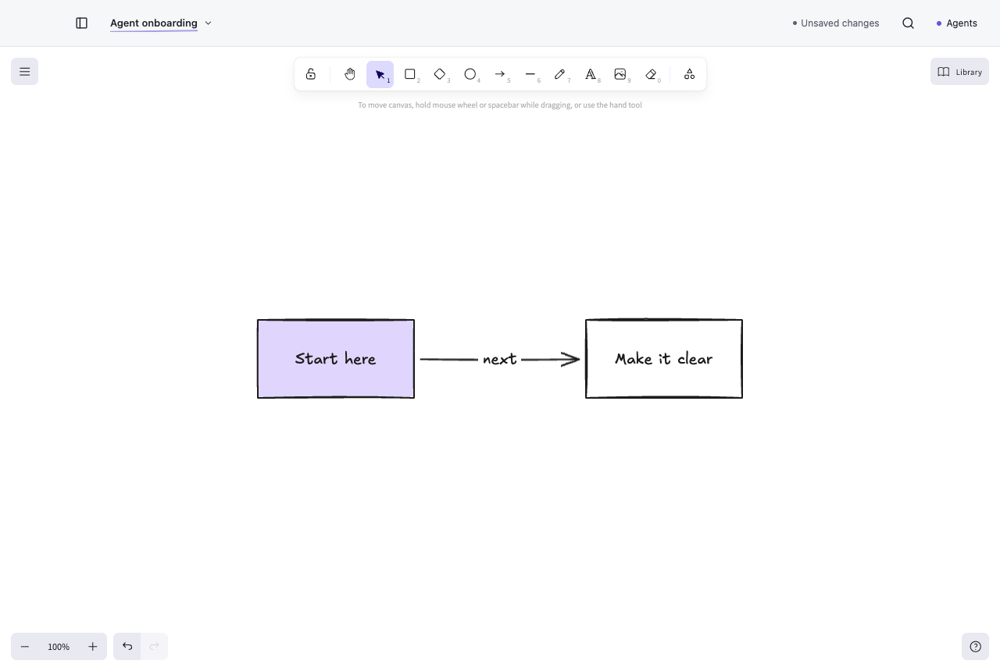

# Agent Excalidraw

A quiet place to think visually, with your agent beside you.

Draw in the official Excalidraw editor, keep ordinary files on your computer, and let your coding agent work on the same canvas through a CLI or optional MCP server. No account or in-app model required.



**Preview software · macOS first.** Source and development builds are available. A signed, notarized public app release and npm registry package are not yet published. Windows and Linux are experimental development targets; native CI results do not make them supported public releases. See the [verification ledger](docs/design/verification-ledger.md).

- **Your files.** Standard `.excalidraw` drawings, visible paths, native Save, local recovery and a searchable library.
- **Your agent.** Create, inspect, edit, render and save through the CLI. MCP exposes the same drawing commands and is optional.
- **Your space.** Minimal chrome, light/dark appearance, no permanent chat panel and no automatic cloud synchronization.

## Start drawing

Until a verified app release is available, run from source with Node.js 22.12 or newer and npm:

```sh
git clone https://github.com/ralfboltshauser/agent-excalidraw.git
cd agent-excalidraw
npm ci
npm run dev
```

Choose **New drawing** or **Open drawing**. New drawings go under `~/Excalidraw` by default; an explicit file path wins. Click the drawing title to see its location. Save with **⌘S**. Recovery snapshots are separate from saving; document autosave is opt-in.

For a local packaged development app, run `npm run package`. Packaging a source checkout does not establish publisher signing or notarization. [Installation, updates and removal](docs/releases.md) explains the available routes and their limits.

## Bring your agent

In the desktop app, open **Agents → Install local launcher**. That launcher uses the app's bundled runtime; a packaged app and its launcher do not require a separate Node installation.

```sh
agent-excalidraw --help
agent-excalidraw skills install --dry-run --json
agent-excalidraw skills install --json
agent-excalidraw skills get core
```

The preview shows the exact paths before installation. One canonical skill source is linked into the selected agent folders; unrelated skills are preserved. Start a new agent session if your host does not reload skills, then ask:

> Use agent-excalidraw to sketch my onboarding flow.

If the command is not on PATH, use `~/.local/bin/agent-excalidraw` on macOS/Linux. From the source checkout, `node dist/cli/index.js` also works after building. Run `agent-excalidraw doctor --json` for install and host diagnostics.

For a fully isolated skill trial:

```sh
agent-excalidraw skills install \
  --home /tmp/excalidraw-trial \
  --data-dir /tmp/excalidraw-trial/app-data \
  --hosts codex,claude --dry-run --json
```

Remove `--dry-run` to install there. Default roots, environment overrides and matching cleanup commands are covered in the [setup guide](docs/releases.md#skills-and-agent-roots).

### Optional MCP

Configure a stdio server in your agent host using its supported configuration format:

```json
{
  "command": "/absolute/path/to/agent-excalidraw",
  "args": ["mcp"]
}
```

Use the actual launcher path shown in Agents. MCP registration is separate from skill installation. The CLI works before registration and after its removal.

## Local files, clear boundaries

Manual editing is designed to work offline with bundled editor assets. Installation and an explicit update check use the network. The app does not contain an AI provider, telemetry or automatic cloud synchronization.

**Content read by your agent is handled by that agent's provider.** Local storage does not make a cloud model local. Drawings, recovery copies and previews are not encrypted by this app. Image exports exclude editable scene data unless you opt in. See [security and privacy](SECURITY.md).

## Current limits

- One active drawing editor; no retained document tabs or multiuser collaboration.
- Semantic CLI creation covers rectangles, ellipses, diamonds, text, lines and arrows. Use the editor for images, freehand drawing and frames.
- Some edits involving bent, elbow or rotated bound arrows are refused rather than silently reshaping them.
- Unknown future element types are refused before editing; compatibility with every future excalidraw.com file is not guaranteed.
- The agent CLI must run on the desktop's machine. Remote/WSL environments are not bridged automatically.
- Native release signing, clean online installation and remaining milestone checks are tracked openly in the [ledger](docs/design/verification-ledger.md).

## Build with us

[Example drawings](examples/README.md) · [Contributing](CONTRIBUTING.md) · [Architecture](docs/architecture.md) · [Product flows](docs/design/product-and-flows.md) · [Milestones](docs/design/milestones.md) · [Release guide](docs/releases.md)

Original code is [MIT licensed](LICENSE). This independent project is not an official Excalidraw release. Excalidraw, Electron, fonts and other dependencies retain their own licenses; see [third-party notices](docs/THIRD_PARTY_NOTICES.md).
