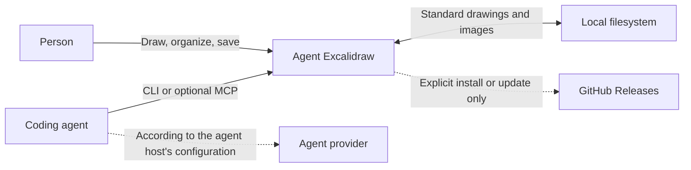
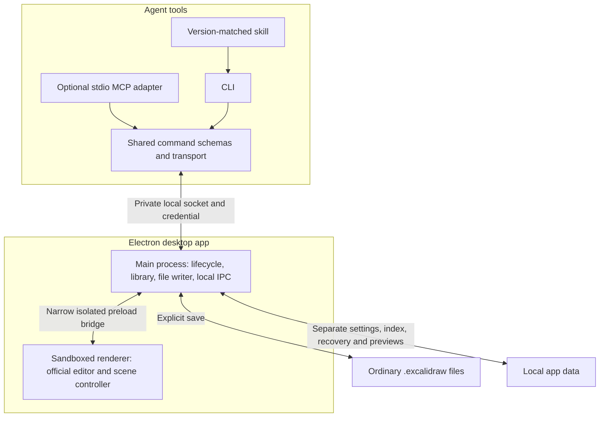

# Architecture

Agent Excalidraw is an independent local workspace built with the official Excalidraw editor. The first distribution targets macOS. Windows and Linux share the implementation and native CI lanes; their release gates are separate.

## System context

Manual editing requires no account, model, API key, MCP configuration or network connection. A cloud agent can transmit content it reads to its provider. Local files do not make that model local, and the app does not encrypt drawings.

## Containers and ownership

The renderer is the **one live scene authority**. Human editing happens inside the editor; main cannot intercept those mutations through its public SDK. Main asks for immutable captures when saving or rendering. Its latest notification is a mirror, never a second writable scene.

The scene controller owns stable element IDs, a content revision and an epoch for the current document incarnation. Agent mutations require document, epoch, expected revision and a request ID. After asynchronous font preparation, it validates these again beside the live editor immediately before applying the batch. React state and elements are flushed together before readback. Native history belongs to Excalidraw; the app promises a tested single undo boundary for supported agent batches, not arbitrary selective undo.

Main serializes document commands and filesystem writes. Stop bypasses the ordinary queue and invalidates both awaiting and queued work for that session. Closing, switching and quitting check the current scene again at admission, including changes made while dialogs were open.

## Files and recovery

Files are standard Excalidraw JSON with embedded local image resources. Ordinary saves omit deleted shapes and unreferenced images. Unsupported future element types are rejected before activation, preventing the pinned SDK from silently dropping them.

A save captures a revision, writes and flushes a sibling temporary file, then publishes it. Only that captured revision becomes saved; later changes stay dirty. Exclusive create/Save As/export refuse collisions. External fingerprints catch observed outside changes and refuse ordinary overwrite; this is best-effort conflict detection, not an atomic filesystem compare-and-swap against other apps.

Recovery snapshots are separate from source files and native undo. Restoring writes a unique copy. Bounded metadata summaries keep recovery listing from rereading entire scenes. Moving a file retains document identity and live unsaved work. Cross-volume failures report remaining source and possible destination copies.

The first release has one active editor, a library and document switching. It does not retain multiple document tabs or implement CRDT collaboration.

## CLI, MCP and skill

Both adapters use `src/shared/commands.ts` and the same validated local protocol. The CLI does not call MCP. Schema parity is tested against a real stdio MCP session. Replies distinguish refusals from uncertain delivery so agents can inspect before retrying. Request receipts are scoped to the live runtime/document epoch, not a durable transaction log.

The CLI can launch an installed desktop app on demand. GUI setup installs a local launcher using the app's bundled runtime. The npm-distributed CLI requires Node 22 or newer and bundles its dependencies. One canonical skill source is linked into selected agent-host roots; installer checks ownership and preserves unrelated configuration. MCP registration is optional and explicit.

## Security and offline boundary

The renderer uses context isolation, sandboxing, no Node integration, a narrow preload, constrained local asset protocol and restrictive content policy. Remote renderer requests are blocked; fonts, chunks and required runtime assets are bundled. Imported remote embeds do not execute. No HTTP edit server, remote debugging endpoint, generic evaluation tool or automatic cloud sync is exposed.

On macOS/Linux the local endpoint directory and socket are owner restricted; a random endpoint credential authenticates requests. Windows uses a named pipe and the same credential. These controls do not sandbox another process already running with the user's permissions.

Explicit update checks use the main process to contact GitHub. The editor does not perform background update checks. Release trust requires signing and notarization evidence in addition to source and package tests. See the [verification ledger](design/verification-ledger.md) for measured results and outstanding gates.

## Source map

- `src/main/files.ts`: file admission, persistence, indexing and recovery.
- `src/main/index.ts`: lifecycle, native menus, command routing and local endpoint.
- `src/renderer/controller.ts`: live revisions, semantic batches, history guards and rendering.
- `src/renderer/main.tsx`: library, editor shell, setup and recovery flows.
- `src/shared/commands.ts`, `src/cli/schema.ts`: command contract and validation.
- `src/cli/`: CLI, MCP, launch/bootstrap and skill installation.
- `scripts/build.mjs`: standalone bundles, local assets and dependency/license inventory.
- `tests/electron.e2e.ts`: real Electron workflows, including packaged-app execution.

Pinned versions and reproducible dependencies are in `package.json` and `package-lock.json`. Product behavior and milestone acceptance criteria are in [user flows](design/product-and-flows.md) and [milestones](design/milestones.md).
