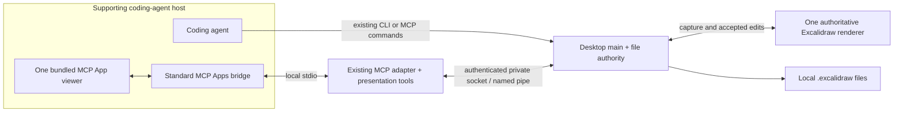

# Shared embedded canvas — researched implementation plan

Planned 2026-11-19; implementation status updated 2026-11-20. E0's actual T3 bridge and the E1–E3 shared implementation now have runtime evidence. All 29 native journeys pass against source and the signed Mac package, including the real stdio viewer chain. E4/E6 host qualification and distribution evidence remain partial; see the [verification report](../verification/embedded-canvas.md). E5 and E7 remain explicit future scope. No HTTP scene server was added.

## Product decision

Build **one optional MCP App viewer**, served by the existing `agent-excalidraw mcp` command. Share its HTML, bridge code, presentation protocol and tests across T3/Codex, T3/Claude and Claude Desktop local stdio. Keep ordinary CLI/MCP commands and the native canvas as the fallback. Host qualification is a test matrix, not three implementations.

The first release is a **live read-only mirror with agent-assisted editing**. Users draw manually in the desktop app; the embedded panel follows acknowledged captures from that same drawing. The agent continues to edit through existing commands. A later explicit selection handoff can connect the panel to agent requests. Full manual Excalidraw editing inside the panel is a separate design gate because it changes editor authority, history and the host's write-approval contract.

No loopback HTTP listener, public tunnel, nested localhost iframe, cloud service, separate drawing engine or per-host UI fork is needed for this release. A browser-facing HTTP adapter remains a separate future integration if it earns its maintenance cost.

## Research that fixes the design

- [Host compatibility review](../research/embedded-host-compatibility.md): Claude Desktop documents local stdio MCP Apps. T3 source provides real UI bridges through its Codex and Claude provider routes. This does not qualify standalone Codex or Claude Code inline rendering.
- [Independent SDK/contract review](../research/embedded-viewer-sdk-review.md): pin `@modelcontextprotocol/ext-apps` **1.7.5**, whose SDK peer range includes our **1.32.2**. The registry default observed was 2.0.4, requiring the split MCP 2.x packages. Avoid an unrelated SDK migration. The exact 1.7.5 source is [92f46a5](https://github.com/modelcontextprotocol/ext-apps/tree/92f46a574568a3ddac7600343b7d3c4c4ed7b588).
- [T3 source investigation](../research/embedded-scenes.md): ordinary HTML replies can show an interactive snapshot; its preview browser blocks private/loopback networking. MCP Apps supplies an actual tool/resource bridge instead.
- [Pinned SDK patterns](https://github.com/modelcontextprotocol/ext-apps/blob/92f46a574568a3ddac7600343b7d3c4c4ed7b588/docs/patterns.md): app-only polling and bounded chunked reads are supported patterns. Resource notifications do not automatically refresh an iframe; the reviewed T3 bridge does not forward subscriptions.
- T3's 5 MiB limit applies to captured HTML. Its 256 KiB message check is **iframe-to-host**, not a demonstrated response limit. Our smaller response budgets below are product choices that still require host tests.
- The current renderer already makes immutable render captures; main currently writes ordinary render/export results to disk. Polling those public commands would create files and change activity indicators. A dedicated in-memory observer path is necessary.
- The renderer has a saved fingerprint, not a historical saved revision. The viewer must use actual dirty state and separately observed save status rather than inventing a `savedRevision` field.

Reference installed metadata observed without launching Claude Code: T3 Personal `0.1.10-preview.20261118.1795025573`, Claude Desktop `6.6395.1`, Codex CLI `0.170.0`. These are starting test candidates, **not qualified versions**. Pin the exact versions actually exercised in E0/E4.

## Architecture and maintenance contract

The deep module is **CanvasPresentation**, hiding document binding, coherent capture/status, image budgets, caching and expiry behind a small interface. Its internal implementation uses the existing renderer and transport. The embedded UI never receives the private endpoint credential and never reads or writes a host file path.

| Code area | Planned responsibility |
| --- | --- |
| `src/shared/presentation.ts` (new) | Versioned request/result schemas, identity, state and byte-budget definitions |
| `src/main/canvas-presentation.ts` (new) | Runtime bindings, bounded immutable captures, cache/coalescing and expiry |
| `src/renderer/controller.ts` | Add observer state/capture admission; reuse current immutable render implementation |
| `src/main/index.ts` | Route validated presentation requests; preserve lifecycle, file guards and normal command behavior |
| `src/cli/mcp-apps.ts` (new) | Capability negotiation, presentation tool/resource registration and result shaping |
| `src/cli/mcp.ts` | Retain the existing 21 domain commands and Reply behavior; delegate optional UI registration |
| `src/embedded/` (new) | Small vanilla TypeScript viewer and CSS using the pinned Apps `App` bridge |
| `scripts/build.mjs` | Bundle one self-contained viewer HTML and include it in CLI/app artifacts and license inventory |
| `package.json` / lockfile | Pin Apps 1.7.5; include `dist/embedded` in the npm allowlist; preserve clean-install compatibility |
| `tests/presentation.*`, `tests/embedded.*` (new) | Real observer/module tests, bridge contract tests and embedded browser journeys |

Keep the current low-level MCP `Server` rather than rewriting all tool registration just to use high-level helpers. Use the pinned SDK's browser bridge, capability helper and protocol constants; generate standard nested metadata in one tested registration module, following the official helper's compatibility normalization. If a later server migration is justified, it has its own parity checks and must not silently alter schemas or errors.

The UI uses capabilities, never product-name or model-name branches. Host differences belong in recorded qualification results and documentation. Set host policy metadata on the **returned resource contents**, not only registration configuration. Do not add host-specific domains or direct-network access for the baseline.

### Presentation interface

Expose **two new MCP presentation tools**, distinct from the 21 shared domain commands:

1. **`show_canvas({document, epoch})`** — model-visible, read-only. Validate the explicitly requested active document against a running compatible app; allocate a runtime binding and associate `ui://agent-excalidraw/viewer-v1.html`. Return a small identity/status summary and versioned binding metadata, without scene JSON or image bytes in model-facing text. Do not implicitly open a file, follow focus or launch an app from an old card.
2. **`canvas_read(...)`** — app-only, read-only, strict discriminated schema:
   - `head({viewId, afterStateToken?})`: validate scope and return unchanged/status-only/new-capture, empty, inactive, expired or unavailable.
   - `chunk({viewId, captureId, offset, byteCount})`: validate the same binding and capture, then return a bounded range of immutable PNG bytes.

The main CanvasPresentation module implements equivalent typed requests over the existing authenticated local protocol. Bindings and assets live there so every chunk can check current document/epoch validity. No arbitrary URI, shell command, output path, export option, file selection or save action is accepted. MCP visibility is enforced in addition to identity checks; annotations alone are not authorization.

Existing drawing/file mutation tools become explicitly **model-only** for UI-capable clients. Preserve ordinary agent calls. This prevents a viewer from gaining the current command surface merely because default visibility includes apps. Verify non-Apps clients still see the expected domain tools, without app-only internals.

The static resource contains only bundled UI code/styles and harmless defaults. No document, path, image or socket credential is baked into it. A changing template protocol gets a new URI. Presentation schema version and desktop feature support are checked explicitly; an old app yields a useful fallback and keeps its current unsaved drawing intact.

The MCP adapter generates its own runtime scope on startup and does not recover it from a historical card. Main binds each view to that scope as well as document/epoch. A restarted adapter cannot reuse the old binding just because the desktop app is still running. Use initial limits of eight bindings per scope, ten minutes idle expiry and a two-hour maximum lifetime; activity can renew idle time but cannot bypass the maximum. Expiry requires a new explicit `show_canvas` call. These limits prevent unnoticed old conversation cards from retaining an indefinitely renewable read route.

### Identity and freshness

- Every binding identifies one document and one open epoch. It never means “whatever is active.” Invalidate on switch/close, epoch change, adapter/app restart or expiry. Reopening the same file requires a new explicit binding.
- At the renderer, synchronize live state, validate document/epoch and clone the scene with its revision before asynchronous image work. Validate the binding again before publishing the finished capture. Main's notification mirror and the saved disk file are not rendering sources.
- Capture pixels have an immutable content revision and capture ID. Display state separately includes actual dirty state, saving/error observations and observation time. Save without an edit must update the status token without rerendering identical pixels.
- An in-progress gesture/text edit may retain the last completed capture with “Editing…” status until a stable read is available. No read changes selection, viewport, native undo, file bytes, recovery or agent activity.
- Already delivered pixels may remain in host history. Expiry prevents future reads; it cannot erase bytes already received by the host.

### Image, queue and lifecycle budgets

Initial engineering budgets, to be measured rather than advertised as host guarantees:

- Static HTML: **at most 1 MiB UTF-8**, no external/relative loads, dynamic chunks, delivered source maps, editor engine or separately loaded fonts. Reuse existing esbuild to inline one browser script and CSS; no single-file plugin dependency is necessary for this small entry.
- Default preview: PNG, `embedScene:false`, longest side initially **1,600 px**. Reduce resolution for large/noisy images; hard limit **4 MiB decoded PNG bytes** and **4 million decoded pixels**. Validate dimensions and byte counts before delivery/decoding.
- `chunk` maximum initially **64 KiB decoded bytes**; base64/JSON overhead is counted separately. This is conservative sizing, not a claim about T3's response ceiling. Capture IDs and offsets refer to decoded bytes, and all chunks must have the same identity/hash/total.
- Cache: **32 MiB total**, bounded capture count, two retained captures per binding, 60-second asset expiry. Limit open bindings per adapter scope; reject excess with a clear error. Record exact choices in implementation tests. A missing/evicted capture is a refreshable state, not partial success.
- One read/download in flight per view; coalesce captures for the same document/epoch/revision/options. Poll about **every two seconds after completion**, with bounded error backoff. No `setInterval` that builds an overlapping queue.
- Reuse existing command ordering first. Measure whether read work delays edits; do not introduce an independent mutation lane. If encoding causes unacceptable queue delay, separate immutable capture from encoding under targeted race tests before proceeding.
- Pause on teardown/pagehide and when iframe-local visibility/intersection says hidden; clean up timers, object URLs and listeners. There is no assumed standardized host visibility field. Include explicit Pause/Resume and Refresh; measure offscreen behavior per host. Backstop missed teardown with server expiry.
- Retry reads only with the same explicit binding. Never bootstrap an app or rebind after connection loss. Ignore late replies by binding/generation, and never replace a newer frame with an older response.

### Privacy and host retention

The host receives the pixels it displays. App-only visibility and `_meta` are not promises of secrecy from the host or model provider. Use synthetic markers to inspect the actual host/provider transcript route before making disclosure claims. Do not automatically call `sendMessage` or `updateModelContext`; those are deliberate sharing operations.

PNG is the first viewer format: it avoids inserting scene-derived SVG into the app DOM and sending original image resources/font metadata unnecessarily. Never put scene text in `innerHTML`, execute diagram links, render active embeds or bake data into a persisted template. Chunk/image data stays out of model-facing text and diagnostics. Existing explicit CLI rendering remains an intentional file-producing fallback.

## User flows and visual contract

1. **Show the drawing:** user asks the agent to show an identified scene; agent opens/snapshots explicitly if needed, then calls `show_canvas`. Panel opens with the scene title, compact Live/Saved or Live/Unsaved status and the canvas as the focus.
2. **Inspect:** drag to pan, wheel/buttons to zoom, Fit, optional host fullscreen. Drawing colors stay true to the document; shell chrome follows host theme. No second drawing toolbar, permanent chat, fake thumbnails or misleading editable cursor.
3. **Watch work:** human edits desktop or agent applies a batch; a successful poll updates pixels and revision. Save changes only the save label if pixels are unchanged. Refresh is always available.
4. **Pause/disconnect:** retain the last frame labelled Paused/Stale with its observation time. Explain whether the drawing became inactive, the app stopped or the provider route is unavailable. Never show another active file or an automatic “Open” action that switches files behind the user.
5. **Empty/large/error:** empty scene is a clear empty state, not export failure. Oversize degrades with a visible preview-quality note or states the limitation. Permissions, incompatible app version and expired captures have distinct, recoverable states.
6. **Open the desktop:** no assumed `file:` or custom-scheme link. A later explicit app-visible focus action may show the already-bound native window after normal host approval, without switching documents. Before that is qualified, give clear desktop guidance; do not promise a button the host cannot execute.
7. **Unsupported host:** ordinary CLI/MCP workflow remains available. Return explicit snapshot/open-in-desktop guidance with exact identity; do not show a blank card or install an HTTP service automatically.
8. **Optional selection handoff (after the base viewer):** select a rectangle on captured pixels. Convert using the capture's transform; bind it to document/epoch/revision. User explicitly sends a short request to the agent. Do not send canvas contents automatically. If the drawing changed, require refreshed selection. The agent takes a fresh scoped snapshot before considering mutations.

Inline layout starts around 420 px canvas height, with compact wrapping controls; fullscreen uses actual host dimensions. Keyboard zoom/fit controls, visible focus, named controls, screen-reader status, 200% UI scaling, light/dark themes and reduced motion are acceptance checks. The image gets a useful summary label, not a claim that a dense diagram is fully screen-reader accessible.

## Milestone implementation and acceptance plan

Every milestone follows: reread plan and previous evidence → implement → run real app/host journey → inspect screenshots → fix → rerun affected checks → commit/push → update subsequent gates. Record exact source/app/adapter/host/provider versions and synthetic fixtures. An unsupported or untested host is not a pass.

### E0 — Prove the actual host contract before feature work

**Build:** a minimal bundled static UI and one read-only synthetic counter tool using pinned Apps 1.7.5 with SDK 1.32.2. No confidential drawing, new filesystem access or document-engine changes. Exercise the intended two-tool metadata/binding route; verify how `_meta` reaches the view.

**Verify:** actual installed T3/Codex first, then Claude Desktop local stdio; qualify T3/Claude separately with the project's subscription-only preflight. Test UI MIME negotiation, initial data, app-only visibility, read-only prompt behavior, theme, fullscreen, stopped provider, ordinary non-Apps client and no network dependencies. Inspect screenshots and host/provider records using synthetic markers.

**Your check:** ask to open the synthetic card, refresh its counter, expand it and resume it after stopping the agent.

**Pass:** at least the primary T3/Codex lane executes the full bridge round trip, with correct fallback in a non-Apps client. Record other lanes independently. **Stop feature expansion if the primary bridge fails.** Resolve a version requirement or change the supported surface openly; do not add a host fork/tunnel as a quiet workaround.

### E1 — Add safe renderer-backed in-memory captures

**Build:** CanvasPresentation schemas, binding/state/capture/chunk implementation and narrow observer routing. Share current render capture logic instead of duplicating rendering. Separate capture revision from display status; add budgets, expiry, cache and coalescing.

**Verify:** real source and packaged Electron: empty scene; fonts/images; unsaved human edit; agent edit; Undo/Redo; Save without content change; switch/close/reopen; delayed capture during switch; app restart; expiry/eviction; invalid chunks. Compare source/recovery files, history, viewport and activity before/after many reads. Prove zero new preview files and no app launch from observer reads.

**Your check:** draw without saving and inspect the captured preview; save and see the status change; switch to a different private synthetic drawing and see the old binding refuse further reads.

**Pass:** immutable bytes and receipts match; no wrong-document pixels, silent side effects, unbounded resources or invented Saved state. Existing 58 module/25 desktop baseline checks remain green, with updated counts recorded.

### E2 — Wire the real optional MCP App

**Build:** static versioned HTML resource, `show_canvas`, app-only `canvas_read`, capability filtering, model-only visibility for existing domain commands and ordinary fallback. Bundle the UI into both npm CLI and desktop ASAR distribution, using module-relative resolution.

**Verify:** real stdio client with/without Apps capability; tool/schema/error parity; valid/invalid resource reads; binding delivery; chunk integrity; old desktop/new adapter; expired historical card. Install the CLI tarball in a clean directory and use the packaged launcher without external Node, outside the repository cwd. Inspect HTML and packages for relative imports, editor bundles, secrets and missing notices. Add the viewer's esbuild metafile to license discovery and explicitly include its output in the npm package allowlist. Verify a clean locked install/build on native CI; an existing node_modules tree does not prove lockfile completeness.

**Your check:** call one normal command and show its canvas from the same server registration. Repeat with UI support absent and obtain a useful ordinary result.

**Pass:** one command/configuration route, no host-specific UI code, no regression to domain commands, working packaged resources and honest compatibility errors.

### E3 — Finish live-view UX and lifecycle

**Build:** pan/zoom/fit, optional fullscreen, status/error/empty states, nonoverlapping polling, pause/resume, cleanup, last-frame stale state and limits. No view-side writes, selection-to-model messages or export controls yet.

**Verify:** actual T3 panel and deterministic bridge/browser tests: delayed/reordered results, rapid Refresh, hidden/offscreen/remount, interrupted chunk read, provider loss, low memory/expiry, dark/light, narrow width, keyboard, focus and reduced motion. Desktop human and CLI edits appear after the next successful poll. Inspect every screen/state and iterate on spacing/hierarchy/contrast.

**Your check:** keep the panel open while drawing and while the agent makes a change; save; pause; hide/reopen; stop/restart the provider. Status always explains what is current.

**Pass:** p95 change-to-visible **under 3.5 seconds after a stable edit** on the reference host with a two-second poll, excluding a host permission wait; unchanged polls perform no render or disk write. Target status reads p95 <100 ms and preview captures p95 <500 ms on the existing 250-element fixture. Investigate >20% regression to ordinary editing/CLI latency. Report actual results and failures rather than silently changing targets.

### E4 — Qualify hosts, privacy, performance and distribution

**Build:** no new feature scope; fix issues revealed by actual hosts and packaging.

**Verify three distinct lanes:** T3/Codex, T3/Claude and Claude Desktop local stdio. Run fresh registration → real unsaved scene → viewer → human edit → agent edit → save → disconnect → restart/reopen → old-card refusal. Record approved/denied host calls, frame policy, actual visible behavior and console/errors. Use subscription-only Claude credentials and secure secret input if a user-only login is unavoidable.

Inspect network activity, retained templates/attachments, synthetic provider transcripts and logs. Confirm pixels are not automatically appended to model-facing polling text and no endpoint token/path is embedded in static HTML. Host storage that cannot be inspected remains an explicit limit. Run the existing small/medium fixtures, image-heavy/Unicode/sparse drawings, and a **30-minute** multi-view/visibility stress test. Cache caps, timers, queue depth and memory must remain bounded; investigate growth instead of claiming leak freedom from one number.

**Your check:** complete the same visual workflow with the same server and UI in each available host; compare behavior, not implementation branches.

**Pass:** qualify only the lanes actually exercised. A broken secondary lane is fixed through the shared contract or documented as unsupported/version-gated. Do not advertise all-three support from a single T3 screenshot. Native Windows/Linux packaging regressions still run in CI, while actual host UI qualification is initially on Mac.

### E5 — Agent handoff and desktop focus (optional, after E4)

**Build:** explicit region selection and user-approved message/context handoff through advertised host capabilities. Add a narrowly scoped focus-existing-desktop action only if shared host tool approvals provide a good UX. Preserve pure viewer behavior when those capabilities are absent.

**Verify:** coordinate transform at multiple zooms; stale selection after human edit; user denial; unavailable messaging; no automatic disclosure; fresh scoped agent snapshot followed by one guarded batch and visible refresh; focus action cannot open/switch a different document. A fallback selectable prompt remains useful without clipboard/message permissions.

**Your check:** select a section, ask the agent to improve it, inspect the refresh and save normally.

**Pass:** preserved IDs/bindings and one-step agent Undo, no stale/wrong-target change, deliberate sharing, same UI source across hosts. No per-pointer write calls or permission spam.

### E6 — Documentation, consumer trial and release

**Deliver:** version-matched skill guidance, one server command, minimal host setup snippets, installed-host support matrix, truthful privacy/retention explanation, screenshots, fallback instructions and migration/version notes. Describe viewer-only versus desktop editing clearly. No automatic edits to unrelated host configuration.

**Verify:** fresh consumer follows only public docs from a packaged CLI/app, registers the server in a qualified host, shows a scene, watches human/agent edits, saves and disconnects while preserving the file and CLI-only workflow. Reopen an old thread after updating the app. Review repository/package contents for synthetic-only evidence.

**Pass:** clean installation/configuration succeeds on declared versions; no duplicated runtime/UI; CLI does not require MCP; all earlier evidence is recorded. Public signed download acceptance remains subject to the existing Mac notarization/clean-download gates, independently of local feature success.

### E7 — Full embedded editing decision gate, not an implied deliverable

After E4/E5, evaluate whether the live mirror plus agent interaction meets the use case. Full manual editing requires a new editor-session design, not enabling buttons in this viewer. Options include a single editor lease transferred to the embedded surface or a deliberately designed shared operation authority; both must address SDK history, queued agent requests, host write approvals, teardown, offline draft recovery and unsaved edits.

Produce a separate technical proof before committing that scope. Do not create two writable scenes or label write traffic read-only to avoid permissions. If a host prevents a usable shared editing contract, retain the common viewer and desktop editor rather than maintaining three proprietary editors.

## Decisions that would change this plan

- Actual E0 host calls do not expose app-only tools or binding metadata correctly: fix metadata/version requirements before writing the viewer.
- A compatible published SDK pin fails the clean dependency/build/host handshake: revise the pin or isolate a measured migration; update evidence and lockfile intentionally.
- Host response constraints defeat bounded chunks or introduce excessive approval overhead: reduce preview/frequency or qualify a resource-read variant through the same module; do not assume a loopback workaround.
- Status polling starves edits or grows memory: change scheduling/capture internals and rerun race/performance tests before expanding scope.
- A host needs remote public hosting for the required base UI: keep that surface outside the local-first release unless an explicit different privacy scope is accepted.

The remaining **E4** work is production host UI qualification, retained-panel/image-heavy stress and a paired no-viewer editing baseline. The signed-package 30-minute six-view run, measured automatic refresh latency, clean npm/ASAR consumer and all four native source/package CI lanes have now passed; exact evidence and limits are in the [report](../verification/embedded-canvas.md). E6 documentation/core guidance and the clean package consumer are delivered, while a complete installed-host UI consumer still depends on E4. Native computer use timed out after the user-authorized resume; do not convert a successful production `show_canvas` call into a visual qualification claim. E5 is a deliberate enhancement, and E7 requires its own accepted design. Nothing here marks the original application's outstanding release gates passed.
