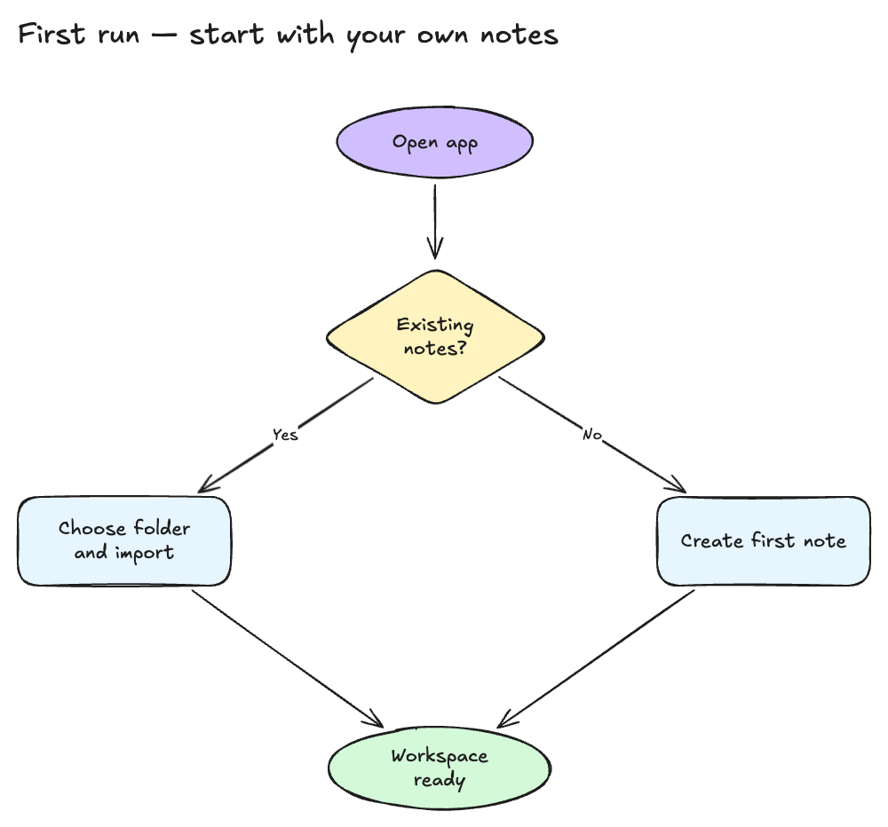
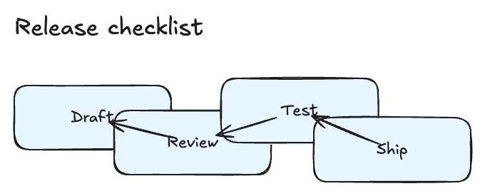
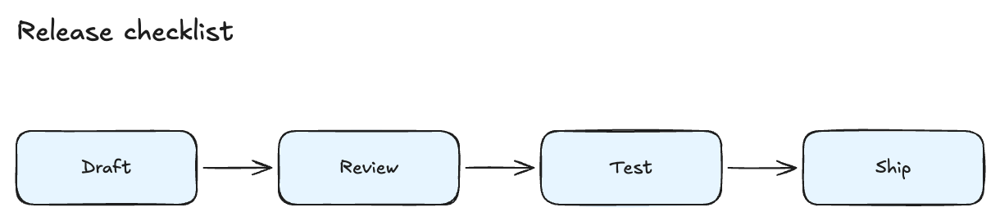

# Example drawings

Synthetic examples created by an independent agent using the installed CLI and public instructions. Open these ordinary `.excalidraw` files in Agent Excalidraw or a compatible editor.

- [Local notes context](local-notes.excalidraw): a person, desktop app, device storage and optional backup.
- [Onboarding flow](onboarding-flow.excalidraw): readable Yes/No branches and a shared destination.
- [Garden plan](garden-plan.excalidraw): a small four-branch mindmap.
- [Annotated sketch](annotated-sketch.excalidraw): an added explanation layer preserving the original rough scene.
- [Refined layout](refined-layout.excalidraw): original identities and bindings retained while overlapping nodes were arranged.

Before and after public CLI layout:

These simple examples demonstrate observed behavior, not a benchmark of arbitrary graph layout. The [consumer report](../docs/verification/design-consumer.md) records the rubric, preservation checks and limitations. All content is synthetic; no private drawings or host paths are included.
